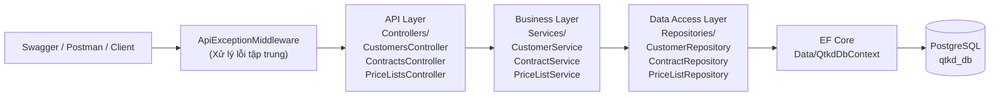
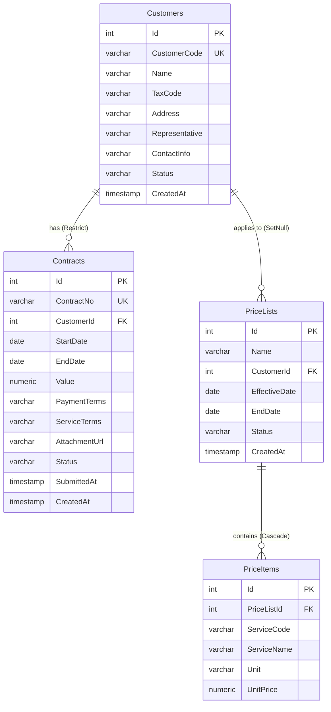

# Kiến trúc Solution & Mô hình Dữ liệu QTKD (Tuần 05)

## 1. Sơ đồ các thành phần chính của Solution

Solution `QTKD.sln` tổ chức theo kiến trúc phân tầng rõ ràng nhằm tách biệt **API**, **xử lý nghiệp vụ** và **truy cập dữ liệu**, tạo nền tảng để mở rộng quy tắc nghiệp vụ ở Tuần 06 và viết kiểm thử xUnit ở Tuần 07.



Luồng xử lý dạng văn bản:
```text
Client / Swagger
  → ApiExceptionMiddleware (bắt ngoại lệ chung, trả JSON UTF-8)
  → Controllers (nhận HTTP request, gọi Service, trả HTTP status + DTO)
  → Services (xử lý nghiệp vụ, ánh xạ Entity ↔ Response DTO)
  → Repositories (truy vấn dữ liệu qua EF Core)
  → QtkdDbContext (ánh xạ bảng, khóa chính, khóa ngoại, index)
  → PostgreSQL (database qtkd_db)
```

---

## 2. Vai trò từng thành phần trong `src/QTKD.Api`

| Thư mục / File | Lớp trách nhiệm | Vai trò cụ thể |
| --- | --- | --- |
| `Controllers/` | Tầng API | Nhận HTTP request (`GET /api/customers`, `GET /api/contracts/{id}`, `GET /api/pricelists`...), gọi Service và trả về status code hợp lý (`200 OK`, `404 Not Found`). Không gọi trực tiếp `QtkdDbContext`. |
| `DTOs/` | Hợp đồng dữ liệu | Tách dữ liệu JSON trả ra cho client (`CustomerResponse`, `ContractResponse`, `PriceListResponse`) khỏi entity EF Core, tránh lộ vòng lặp navigation property. |
| `Services/` | Tầng xử lý nghiệp vụ | Trung gian giữa Controller và Repository; nơi sẽ đặt kiểm tra business rules (`CTR-01`, `CTR-02`, `CTR-03` và US03 submit) ở Tuần 06. |
| `Repositories/` | Tầng truy cập dữ liệu | Đóng gói các câu truy vấn EF Core (`AsNoTracking`, `Include`, `OrderBy`) giúp Service không phụ thuộc trực tiếp vào truy vấn DB và dễ unit test ở Tuần 07. |
| `Models/` | Mô hình thực thể | Chứa 4 entity chính (`Customer`, `Contract`, `PriceList`, `PriceItem`) và hằng số trạng thái (`QtkdStatuses.cs`). |
| `Data/` | EF Core & Seed | `QtkdDbContext` cấu hình bảng, PK, FK, Unique Index, kiểu decimal; `QtkdDbSeeder` khởi tạo dữ liệu mẫu idempotent khi database chưa có dữ liệu. |
| `Migrations/` | Quản lý schema | Lưu lịch sử migration (`InitialCreate`) để đồng bộ cấu trúc database trên mọi máy. |
| `Middleware/` | Hạ tầng HTTP | `ApiExceptionMiddleware` chuẩn hóa phản hồi lỗi JSON khi phát sinh ngoại lệ. |
| `Program.cs` | Khởi tạo & DI | Đăng ký `QtkdDbContext` (Npgsql), Repository, Service bằng Dependency Injection, bật Swagger ở Development và gọi `QtkdDbSeeder`. |

---

## 3. Sơ đồ mô hình dữ liệu (ERD)



### Ràng buộc chính trong PostgreSQL
- **Khóa chính (PK):** `Id` (identity tự tăng) cho cả 4 bảng.
- **Khóa ngoại (FK):**
  - `Contracts.CustomerId` → `Customers.Id` (`ON DELETE RESTRICT`: không cho xóa khách hàng đã có hợp đồng).
  - `PriceLists.CustomerId` → `Customers.Id` (`ON DELETE SET NULL`: cho phép bảng giá gắn khách hàng hoặc bảng giá chung).
  - `PriceItems.PriceListId` → `PriceLists.Id` (`ON DELETE CASCADE`: xóa bảng giá sẽ xóa các dòng đơn giá thuộc bảng giá đó).
- **Unique Index:**
  - `Customers.CustomerCode` (mã khách hàng duy nhất).
  - `Contracts.ContractNo` (số hợp đồng duy nhất, ví dụ `HD-2026-018`).
  - `(PriceItems.PriceListId, PriceItems.ServiceCode)` (không trùng mã dịch vụ trong cùng một bảng giá).

---

## 4. Đối chiếu đặc tả Phase 1 & Giả định thiết kế

Thiết kế bám theo tài liệu đề tài **Quản trị kinh doanh — Công ty ABC (Logistics & Khai thác cảng)** (`QTKD_DATH.pdf`) kết hợp yêu cầu tối thiểu của `TH_Phase2_QTKD.pdf`:

1. **Khách hàng (`Customer` — Mục 4.1):** Lưu đầy đủ các trường tối thiểu (`Id`, `Name`, `Status`) cùng các trường nghiệp vụ (`CustomerCode`, `TaxCode`, `Address`, `Representative`, `ContactInfo`).
2. **Hợp đồng (`Contract` — Mục 4.2):** Lưu đủ `Id`, `ContractNo`, `CustomerId`, `StartDate`, `EndDate`, `Status` cùng `Value`, `PaymentTerms`, `ServiceTerms`, `AttachmentUrl`, `SubmittedAt`.
3. **Bảng giá (`PriceList`, `PriceItem` — Mục 4.4):** Lưu `Name`, `CustomerId`, `EffectiveDate`, `EndDate`, `Status` và các hạng mục dịch vụ (`ServiceCode`, `ServiceName`, `Unit`, `UnitPrice`).
4. **Giả định chuẩn bị cho Tuần 06 (US03 & CTR-01..03):**
   - **Ánh xạ trạng thái:** Sơ đồ tổng quát Phase 1 dùng tên `Submitted`, còn hướng dẫn thực hành Tuần 06–07 dùng tên `PendingApproval`. Hệ thống thống nhất dùng `PendingApproval` cho trạng thái sau khi gửi duyệt (và ghi rõ ánh xạ tương đương `Submitted` theo cho phép điều chỉnh ở Mục 5 của đặc tả).
   - **Nội dung/tệp bắt buộc theo `CTR-02`:** Giả định dùng trong bản demo là hợp đồng phải có `ServiceTerms` (điều khoản dịch vụ), `PaymentTerms` (điều khoản thanh toán) và `AttachmentUrl` (đường dẫn/tên tệp đính kèm) không rỗng. Dữ liệu mẫu `HD-2026-018` ở Tuần 05 cố ý để `AttachmentUrl = null` ở trạng thái `Draft` để Tuần 06 demo đúng luồng *gửi thiếu thông tin (thất bại) → bổ sung tệp đính kèm → gửi lại (thành công)*.
